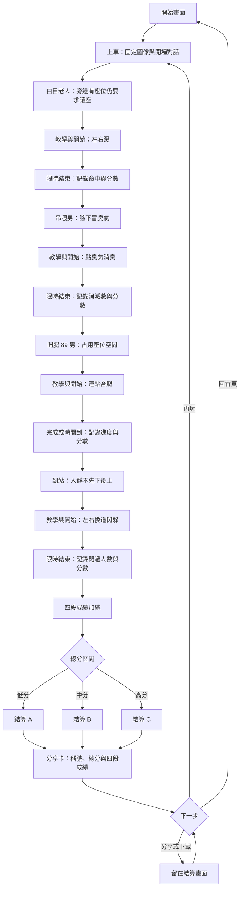

# 台灣捷運迷因 Web Game — PLAN

## 2026-10-19：main 完整五關開發

本節優先於所有歷史規劃。總共 **五關**：接尿 → 老人 → 消臭 → 合腿 → 下車；每關 100 分，總分 500，結算門檻 200／350。`release/v1` 的兩關限制只適用已部署版本，不套用到 main。

- 保留接尿關與老人 v12、直接點擊踢擊及三階段傷勢。
- 沿用原生 JavaScript + DOM/CSS，不改引擎、不增加後端。
- 補齊後三關 Wojak 圖像：吊嘎男、合腿姿勢、人群；保留可玩的現有規則，素材和提示詞放既有 assets 目錄。
- 遊戲順序、總分、分享卡、重玩皆須涵蓋五關。
- 驗證所有關卡的操作、低分結算、暫停、重玩、窄螢幕布局及素材載入；實體手機與原生分享另記錄未驗證項目。
- 宣傳錄影保留本機，`output/promo/` 不納入 Git。

### 本輪進度

- [x] 回到 main 並忽略影片輸出。
- [ ] 後三關正式 Wojak 素材與整合。
- [ ] 五關瀏覽器回歸、計分與手機尺寸驗證。
- [ ] 更新驗收紀錄並提交、推送 main。

以下為歷史設計紀錄，其中四關／400 分、老人左右按鈕及 Phaser 選型已被最新規劃取代。

## 2026-10-18 更新：新增第一關與 Wojak 角色定稿

本節為最新規劃，優先於下方歷史規劃。2026-10-18：新接尿關已實作，角色動作圖、背景、桶子與尿滴及完整提示詞已存入既有 assets 目錄；實體手機驗收仍待完成。

- 關卡順序：捷運座椅接尿 → 原有老人 → 消臭 → 合腿 → 下車。保留老人 v12 與既有玩法，不刪除、不重製。
- 新第一關：黑人男性站在捷運綠色座椅前排尿，玩家左右移動桶子接住尿流，漏接會落在座椅上。重點是排尿與接尿，不是事後清潔地板。
- 操作與節奏：暫定 12 秒、三條接取位置，手機左右按鈕、桌面左右鍵。落點先有可讀提示，再判定接取；配置須留有換位時間，避免無解。接到加分，漏接留下座椅尿漬；時間到結算。
- 五關各 100 分，總分改為 500；新關按成功接取比例計分。結算門檻暫定 200／350 分，後續接入時同步修改分享卡與測試。
- 背景固定，角色、桶子、尿流及水花分層。排尿以黃色弧線／水滴動畫表現，不露生殖器。車廂背景另外製作，不烘焙進角色圖。

### 角色美術：臉必須一眼就是 Wojak

- 明確為成年黑人男性，深棕膚色；花襯衫、藍短褲、斜背包、灰色球鞋、短捲髮。
- 使用使用者提供的 Wojak 拼圖作「臉部畫法」參考：手繪不規則黑色輪廓、簡化眼睛、重眼皮與眼袋、眉間與鼻唇線、偏長的臉和克制的迷因表情。臉部辨識優先於衣服細節。
- 平塗、少陰影、刻意粗糙的網路迷因質感；避免寫實肖像、精緻商業卡通、3D、動漫大眼。不是只把一般卡通人物換成深色皮膚。
- 全身三分之二側身朝右、頭回望觀眾，臉可讀，手在腰際且衣著完整；透明背景、腳底完整、底部中央錨點。
- 本輪先生成一張基準角色圖，沿用既有的 `assets/characters/`，完整提示詞同目錄保存；不另建角色資料夾。
- 先檢查臉部 Wojak 辨識度、服裝、透明度及遊戲縮圖可讀性，再以這張基準圖延伸動畫；動畫採同一張基準圖生成完整序列，保持臉型與比例一致。

### 執行順序與技能

1. 更新本計畫。
2. 使用 `game-studio` 路由到 `sprite-pipeline`，由 `imagegen` 生成透明角色圖並保存原始提示詞。
3. 已完成角色素材、新關、綠色座椅背景與尿流／接取回饋。
4. 驗證接取判定、漏接、暫停、重玩、五關流程及 500 分分享卡；實體手機驗收仍待完成。

---

> 狀態：MVP 已實作，桌面與手機尺寸瀏覽器流程已驗證；實體手機驗收待完成。詳見 README.md 與 docs/QA.md。
> 以下保留原始規劃；「暫定」數值可依手機實測調整。2026-10-17 實作採原生 JavaScript + DOM/CSS，老人使用 v12。

## 1. 遊戲方向

- 已確認：2D、mobile-first、搞笑迷因、容易分享，單局目標 3–5 分鐘。
- 已確認：對話式 RPG 呈現，固定背景與角色圖，主要透過對話框推進，不需要自由移動。
- 已確認：三位 NPC 對話後各觸發小遊戲；下車另外觸發人群閃躲。
- 已確認：限時挑戰，四段成績加總決定不同結算。
- 暫定：「先三個」解讀為三種結算結果，保留三位 NPC 與下車挑戰。
- 固定圖像用於劇情；小遊戲以圖片位移、表情替換與簡單特效呈現，不必製作完整角色動畫。
- 第一版暫採固定順序。原先隨機事件池延後，挑戰內方向／位置／人群配置可隨機。

## 2. Game flow / core loop

**上車 → 老人對話／左右踢 → 吊嘎男對話／消臭 → 89 男對話／連點合腿 → 到站對話／下車閃躲 → 總分結算 → 分享或重玩。**

每段共同循環：對話 → 一句操作教學 → 按開始 → 倒數 → 限時挑戰 → 本段分數與回應對話 → 下一段。低分仍繼續，不中途淘汰。

### 時間預算（暫定）

| 段落 | 時間 |
| --- | --- |
| 開場／上車 | 15–25 秒 |
| 三位 NPC 的對話、教學與回饋 | 每段 15–25 秒，共 45–75 秒 |
| 三位 NPC 挑戰 | 每段 25 秒，共 75 秒 |
| 下車對話與教學 | 10–20 秒 |
| 下車挑戰 | 30 秒 |
| 結算閱讀 | 10–25 秒 |

合計約 185–250 秒。對話點擊繼續，不強制計時；實際閱讀速度與合腿提早完成會影響局長，需試玩調整。分享停留另計。

## 3. NPC 與四款小遊戲

### G01 白目老人 — 左右踢

情境：旁邊明明有座位，老人仍堅持要玩家讓座。玩家出腳，老人左右閃躲，命中越多得分越高。

- 手機底部兩個大按鈕「踢左」「踢右」；桌面點同樣按鈕，可補左右鍵。
- 暫定老人出現在左／右兩側。玩家踢他當下所在側算命中，踢空側算落空。
- 老人移動方向／位置需清楚可見，留下反應時間，避免玩家按下後才無提示換位。
- 暫定固定閃躲回合數、方向隨機，每回合最多計一次命中；踢擊有短冷卻，避免同時按兩側保證命中。
- 顯示腳的圖片與命中／落空回饋，暫定 25 秒。
- 記錄有效回合、命中、落空；動作冷卻與反應窗口待測試。
- 待確認：是否改成預判老人「下一步」？目前採踢當下位置。

玩法類型接近雙方向反應／打地鼠式挑戰，使用本作原創角色與演出。

### G02 臭臭穿吊嘎胖子男 — 芳香劑消臭

情境：角色腋下持續冒臭氣，玩家點臭氣，以芳香劑消滅它。

- 手機直接點臭氣，桌面滑鼠點；暫不需要拖曳芳香劑瓶子。
- 臭氣由腋下生成、短暫漂移後消散；點中播放噴霧、消滅一團並加分。
- 暫定固定生成總量／速度，位置隨機。生成區避開 HUD，點擊範圍適合手指。
- 同一團只能計分一次；漏掉或點空暫不扣分。
- 暫定 25 秒，記錄生成數、消滅數、漏掉數。

### G03 開腿 89 男 — 連點合腿

情境：玩家連點，把角色張開的腿慢慢合上，速度越快分數越高，有上限。

- 手機點底部大操作區「合起來！」，桌面點同一區域。
- 每次有效按下增加合腿進度，以腿部圖層位移／旋轉或分段圖片呈現。
- 暫定限時 25 秒。到 100% 記錄完成時間，鎖定成績，提早進入回饋對話。
- 未完成則按進度取得部分分數。暫不加入腿自動張回去的機制。
- 一次按下計一次，長按不自動連點，同時多指不疊加。
- 記錄有效點擊數、最終進度、完成時間；所需點擊數由手機實測決定。

### G04 下車 — 閃避不先下後上的人群

情境：玩家下車時遇到搶上車人群，左右閃躲，每成功閃過一人得分。

- 暫定三條直向路徑，玩家在下方，人群從上方接近。
- 手機底部「往左」「往右」按鈕，每次移動一道；桌面點按鈕或左右鍵。
- 人群越過玩家判定線時，不同道算閃過、同道算碰撞；同一人只判定一次。
- 碰撞只有回饋與該人不加分，不終止旅程。
- 暫定固定人群總量／速度，使用可通行的隨機配置，不同時封死三道；間距需允許換道反應。
- 暫定 30 秒，記錄出現人數、成功閃過數、碰撞數。

## 4. 計分與三種結算（暫定）

每款換算為 0–100 分，四段相加為 0–400，避免連點次數壓過其他玩法。

| 挑戰 | 計分草案 |
| --- | --- |
| 老人 | 命中數 ÷ 有效回合數 × 100 |
| 消臭 | 消滅數 ÷ 生成總數 × 100 |
| 合腿 | 未完成：進度比例 × 60；完成：60 + 40 × 剩餘時間比例 |
| 下車 | 成功閃過數 ÷ 人群總數 × 100 |

各段四捨五入為整數，限制在 0–100。生成總量／回合數需固定且大於零，只納入時間內可完成判定的目標，避免最後一秒生成卻無法處理。計時只計有效遊戲時間。

| 結算 | 暫定總分 | 稱號／內容 |
| --- | --- | --- |
| A 低分 | 0–159 | 待提供 |
| B 中分 | 160–279 | 待提供 |
| C 高分 | 280–400 | 待提供 |

分數門檻是測試起點，手機試玩後再調整。結算顯示稱號、迷因文案、總分與四段成績；全部結果都代表完成旅程。

## 5. 第一版 MVP scope

| 項目 | 第一版範圍 |
| --- | --- |
| 旅程 | 固定順序的開場、三位 NPC、下車、結算 |
| 對話 | 姓名、角色圖、對話框、點擊繼續；暫無分支 |
| NPC | 三位指定角色；下車人群重用少量通用人物 |
| 小遊戲 | 四款，各有一句教學、開始、時間、分數與回饋 |
| 結算 | 三種結果、總分及四段成績 |
| 分享 | 一個卡片版型；支援時分享，否則下載圖片 |
| 設定 | 音效開關、暫停、重玩 |
| 裝置 | 手機直式為主，桌面滑鼠可完整遊玩 |

延後：自由移動、裝備／戰鬥系統、隨機事件池、分支劇情、多路線、多人、帳號、排行榜、後端、養成與完整逐格動畫。

## 6. 場景與 assets 清單

體驗場景：開始／上車、共用車廂對話、四款挑戰、結算／分享。這不代表每段都要各建一個引擎 Scene。

| 素材 | 需求 |
| --- | --- |
| 背景 | 車廂座位、車門下車；直式構圖，上車可沿用車門圖 |
| 老人 | 基礎圖、左右閃躲、被踢反應；可用位移／鏡像與表情替換 |
| 吊嘎男 | 腋下可見的角色圖與反應表情，預留臭氣生成區 |
| 89 男 | 身體＋左右腿分層，或開腿／半合／合上分段圖片，擇一 |
| 玩家腳 | 左踢／右踢，或可鏡像的圖片 |
| 消臭道具 | 芳香劑瓶身、臭氣團、噴霧 |
| 下車人物 | 玩家圖、少量人群圖，位移即可，不要求走路動畫 |
| UI | 對話框、姓名欄、繼續提示、左右按鈕、合腿按鈕、時間／分數／進度 |
| 結算 | 三種結果圖或表情、共用分享卡背景 |
| 特效／音效 | 命中、落空、消臭、合腿、碰撞、到站、點擊；靜音仍可理解 |

先確認畫風、視角、比例與分層方式，再製作素材。角色／道具透明背景，固定錨點，以 asset ID 管理。對話文字不用烘焙入圖片；先占位驗證操作，現階段不生成圖片。

## 7. Mobile-first UI 與操作

- 直式布局：上方時間／分數，中間人物與挑戰，下方對話框或操作按鈕。
- 對話「繼續」與小遊戲「開始」分開，避免翻頁點擊直接誤觸挑戰。
- 大按鈕與臭氣命中區暫以至少 48 CSS px 作設計起點，實際依手機試玩調整。
- 統一觸控與滑鼠輸入，避免同一次操作被 touch／click 重複計分。
- 遊戲操作區防止誤捲動、文字選取、雙擊縮放；對話區保留必要捲動。
- 保留瀏海與底部安全區；尺寸改變時重新對齊物件與命中區。
- 暫停或切到背景時停止計時、生成與輸入，回來後明確恢復。
- 音訊在玩家操作後啟動，可靜音；必要資訊同時有視覺提示。

## 8. 技術評估與架構

暫推薦 **Phaser + TypeScript + Vite，搭配 DOM 對話／結算介面**。劇情層是固定圖片，但四款挑戰需要位移、目標生成、命中／碰撞、計時與輸入管理，可共用 2D 遊戲層。

替代方案為 TypeScript + DOM/CSS，適合對話占主體的作品，但需自行管理四款挑戰的更新與判定。第一版暫不加 React 或後端。版本、官方 API 與瀏覽器細節在實作前再查核。

- 劇情流程：目前段落、對話索引、下一個挑戰。
- 對話資料：角色、台詞、表情、小遊戲 ID，與邏輯分離。
- 小遊戲狀態：時間、目標、有效輸入、原始成績，獨立於渲染物件。
- 共用挑戰介面：開始、暫停、恢復、結束，回傳原始結果與換算分數。
- 計分／結算：每段只提交一次，四段總分決定唯一結果。
- 畫面：遊戲層處理圖片與特效，DOM 處理對話和文字介面。
- 分享：結算資料產生卡片，檢查分享能力並提供下載備援。

純前端靜態部署，設定可存本機；中途續玩暫不做。除錯可直接進指定挑戰並固定亂數種子，發布時隱藏入口。

## 9. 開發與驗收順序（尚未開始）

1. 確認台詞、畫風、老人命中規則、三種結算。
2. 占位版驗證四款手機操作，調整節奏、目標數與計分。
3. 接通對話、小遊戲、下車與結算。
4. 加正式圖片、演出、音效與分享卡。
5. 手機與桌面實測，調整整局時間。

驗收重點：所有挑戰可完成、低分可結算；老人有反應窗口；臭氣不重複計分；合腿有上限且速度影響成績；下車每人只判定一次且有可通行路徑。四段分數 0–100、總分 0–400，結算門檻無空隙。手機無重複觸發或誤縮放；背景切換不扣時間；重玩清空狀態；中文與按鈕在窄螢幕可讀；分享／下載內容正確。

邏輯驗證聚焦計分邊界、限時結束與流程切換；人工試玩確認操作公平、連點可達性、笑點與 3–5 分鐘節奏。

## 10. 待補內容與決策紀錄

待補：遊戲名稱、路線／站名、主角設定、台詞、畫風與視角、老人當下位置或預判的判定選擇、三種結算稱號／文案／圖片。各段時間、冷卻、生成總量、合腿點擊門檻與結算分數待試玩調整。

| 狀態 | 決策 |
| --- | --- |
| 已確認 | 固定圖像、對話框，不需要 RPG 移動 |
| 已確認 | 三位 NPC 小遊戲，加下車閃躲，共四款 |
| 已確認 | 手機能玩、限時、加總分數 |
| 暫定 | 三種結算、固定順序、每段 100 分 |
| 暫定 | Phaser 與 DOM 分工 |
| 已確認 | 目前仍只規劃，尚未開始實作 |
